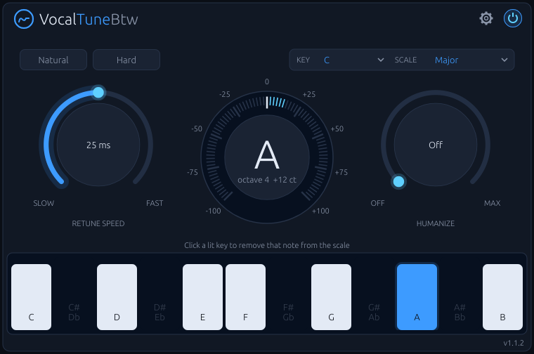
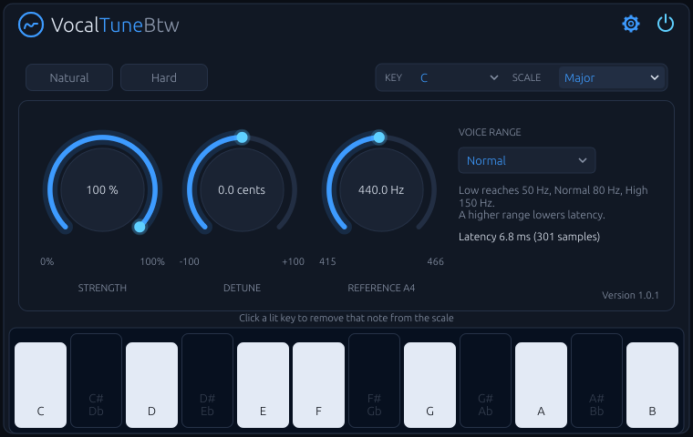

# VocalTuneBtw

**Real-time pitch correction for monophonic vocals, built natively for Linux.**

VocalTuneBtw listens to a single voice, finds the nearest note in the key and
scale you choose, and glides the voice onto it. Set it fast for the hard,
robotic snap. Set it slow for transparent correction that keeps vibrato and
slides intact. It runs as a VST3 or CLAP plugin and as a Standalone app.



## Features

- **Key and scale snapping.** 12 root notes and 14 scales: Chromatic, Major,
  Natural/Harmonic/Melodic Minor, Dorian, Phrygian, Lydian, Mixolydian,
  Locrian, Major/Minor Pentatonic, Blues and Custom.
- **Per-note control.** The keyboard shows one octave with every note once.
  Click a lit key to remove that note from the scale; the voice then snaps to
  the neighbouring notes instead. Click it again to bring it back.
- **Retune Speed from 1 to 200 ms.** One-click **Natural** (50 ms, light
  humanize) and **Hard** (1 ms, no humanize) presets.
- **Humanize.** Notes that are already close to the target are left alone,
  so held notes keep their natural movement.
- **Strength, Detune and Reference pitch.** Partial correction, an offset of
  up to ±100 cents, and A4 tuning from 415 to 466 Hz.
- **Live tuning meter.** Shows the target note, its octave and the deviation
  in cents. The keyboard highlights the note being corrected.
- **Low latency.** 3.8–10.8 ms depending on the voice range. The plugin
  reports it to the host for automatic delay compensation.
- **Click-free bypass**, exposed to the host and automatable.
- **Mono or stereo.** Stereo channels are shifted together, so the image
  stays intact.
- **Real-time safe.** No memory allocation, locks or I/O on the audio thread;
  a test enforces it.

## Screenshots

| Correcting a note | Settings (behind the gear icon) |
|---|---|
|  |  |

## Controls

### Main view

| Control | Range | What it does |
|---|---|---|
| Key / Scale | 12 roots × 14 scales | The notes the voice is pulled to. |
| Keyboard | per note | One octave. Lit keys are in the scale; the note being corrected is blue. Click a key in the scale to switch it off (dark) or on again. |
| Retune Speed | 1–200 ms | How fast the voice moves to the target. Low values give the hard, stepped effect. |
| Humanize | Off–100 % | Deviations smaller than this are left uncorrected (0–50 cents). |
| Natural / Hard | presets | Set Retune Speed and Humanize in one click. The active preset lights up. |
| Power | on / off | Bypass with a 10 ms crossfade. The switch is blue while the effect runs; while bypassed it turns grey and the tuning meter dims. |

### Settings

| Control | Range | What it does |
|---|---|---|
| Strength | 0–100 % | How much of the pitch error is corrected. |
| Detune | ±100 cents | Shifts every target note by a fixed amount. |
| Reference A4 | 415–466 Hz | Concert pitch the scale is tuned to. |
| Voice Range | Low / Normal / High | The singer's range. Sets both the detection range and the latency. |

All controls are host parameters and can be automated. Parameter IDs and
details are in [docs/architecture.md](docs/architecture.md).

## Latency

The pitch shifter needs about half a cycle of the lowest note it must handle,
so a higher Voice Range means lower latency. Values at 48 kHz:

| Voice Range | Lowest note | Latency |
|---|---|---|
| Low | 50 Hz | 10.8 ms |
| Normal | 80 Hz | 6.8 ms |
| High | 150 Hz | 3.8 ms |

Pick the highest range that still covers the singer's lowest note. The
current value is shown on the settings page.

Note detection also needs some audio before it recognises a new note, so the
start of a note is corrected roughly 25–30 ms late. This doesn't delay the
audio itself.

## How it works

1. **Detection.** The input is low-pass filtered, downsampled to about 16 kHz
   and analysed every 2.5 ms with the YIN algorithm.
2. **Target.** The detected pitch is mapped to the nearest enabled note of the
   key and scale. Hysteresis prevents flicker between two notes.
3. **Correction.** The pitch shift glides towards the target at the Retune
   Speed, scaled by Strength and offset by Detune.
4. **Shifting.** A pitch-synchronous splice shifter reads the delayed signal
   at a different speed. It jumps back or forward by whole cycles of the
   voice, with short crossfades, so the splices stay in phase. Where no
   pitch is detected, it jumps to where the waveform matches best.

The DSP code in `src/dsp` is plain C++20 with no JUCE dependency and is
tested on its own. The full design is in
[docs/architecture.md](docs/architecture.md).

## Download

Prebuilt VST3, CLAP and Standalone binaries for x86-64 Linux are on the
[Releases page](https://github.com/PluginsBTW/VocalTuneBtw/releases).
Extract the archive and copy `VocalTuneBtw.vst3` to `~/.vst3/`, or
`VocalTuneBtw.clap` to `~/.clap/`. Each
release lists the glibc version it needs; on older systems, build from
source.

## Building

### Requirements

- Linux on x86-64
- A C++20 compiler (tested with GCC 16)
- CMake 3.25 or newer
- git (CMake downloads JUCE and the other dependencies at configure time)
- Ninja (optional; used automatically when installed)
- JUCE's Linux libraries: ALSA, FreeType, fontconfig and X11
  (Xrandr, Xinerama, Xcursor, Xext, Xrender, Xcomposite, Xi)

Arch Linux:

```bash
sudo pacman -S --needed base-devel cmake ninja git alsa-lib freetype2 fontconfig libx11 libxrandr libxinerama libxcursor libxext libxrender libxcomposite libxi
```

Debian / Ubuntu:

```bash
sudo apt install build-essential cmake ninja-build git libasound2-dev libfreetype-dev libfontconfig1-dev libx11-dev libxrandr-dev libxinerama-dev libxcursor-dev libxext-dev libxrender-dev libxcomposite-dev libxi-dev
```

### Build

```bash
git clone https://github.com/PluginsBTW/VocalTuneBtw.git
cd VocalTuneBtw
scripts/build-linux.sh
```

This configures a Release build in `build/`, compiles every format and runs
the tests. The first run downloads JUCE and takes a few minutes.

Script options:

| Option | Effect |
|---|---|
| `--tests` | Build and run only the DSP tests in `build-tests/`. Doesn't download JUCE, so it is fast. |
| `--debug` | Debug build instead of Release. |

Plain CMake works too:

```bash
cmake -S . -B build -G Ninja -DCMAKE_BUILD_TYPE=Release
cmake --build build --parallel
ctest --test-dir build --output-on-failure
```

| CMake option | Default | Effect |
|---|---|---|
| `PITCHPILOT_BUILD_PLUGIN` | `ON` | Build the plugin and Standalone app (needs JUCE). |
| `PITCHPILOT_BUILD_CLAP` | `ON` | Also build the CLAP format. Turn off for VST3 and Standalone only. |
| `PITCHPILOT_BUILD_TESTS` | `ON` | Build the unit tests (Catch2). |

### Output

```
build/src/plugin/VocalTuneBtw_artefacts/Release/VST3/VocalTuneBtw.vst3
build/src/plugin/VocalTuneBtw_artefacts/Release/CLAP/VocalTuneBtw.clap
build/src/plugin/VocalTuneBtw_artefacts/Release/Standalone/VocalTuneBtw
```

### Install

The build never installs anything. To install for your user:

```bash
mkdir -p ~/.vst3 && cp -r build/src/plugin/VocalTuneBtw_artefacts/Release/VST3/VocalTuneBtw.vst3 ~/.vst3/
```

```bash
mkdir -p ~/.clap && cp build/src/plugin/VocalTuneBtw_artefacts/Release/CLAP/VocalTuneBtw.clap ~/.clap/
```

Then rescan plugins in your host. The plugin is listed as **VocalTuneBtw**
under Fx › Pitch Shift.

The plugin used to be called PitchPilot. It keeps the same plugin ID, so
older projects still load it. Delete `~/.vst3/PitchPilot.vst3` so the host
doesn't list the plugin twice.

## Project layout

```
src/dsp/      pitch detection, scales, correction and shifting (no JUCE)
src/plugin/   JUCE processor, parameters and editor
src/ui/       look and feel, knobs, tuning meter, keyboard, main panel
tests/        Catch2 tests: pitch accuracy, scales, correction, shifter, real-time safety, clicks
tools/        vtb-render: offline renderer with pitch-error and click metrics (no JUCE)
assets/       the Ubuntu Light font and its licence
docs/         architecture, DSP evaluation, licensing, release notes, screenshots
scripts/      build and packaging scripts
```

## License

VocalTuneBtw is free software under the **GNU Affero General Public License
v3.0 or later** (AGPL-3.0-or-later). The full text is in
[LICENSE.md](LICENSE.md).

You may use, study, modify and share it. If you distribute binaries or a
modified version, you must also make the complete source code available
under the same licence.

Third-party code:

| Dependency | Licence | Used for |
|---|---|---|
| [JUCE](https://juce.com) 9.0.4 | AGPLv3 (used under this option) | plugin framework, GUI, VST3 and Standalone wrappers |
| VST3 SDK (bundled with JUCE) | MIT | VST3 interfaces |
| [clap-juce-extensions](https://github.com/free-audio/clap-juce-extensions) | MIT | CLAP wrapper |
| CLAP, clap-helpers | MIT | CLAP interfaces |
| [Catch2](https://github.com/catchorg/Catch2) 3.7.1 | BSL-1.0 | unit tests only, not shipped |
| [Ubuntu](https://design.ubuntu.com/font) Light font | Ubuntu Font Licence 1.0 | the interface typeface, embedded in the editor |

The dependency audit and what distributing binaries requires are in
[docs/licensing.md](docs/licensing.md).

VST is a registered trademark of Steinberg Media Technologies GmbH.
